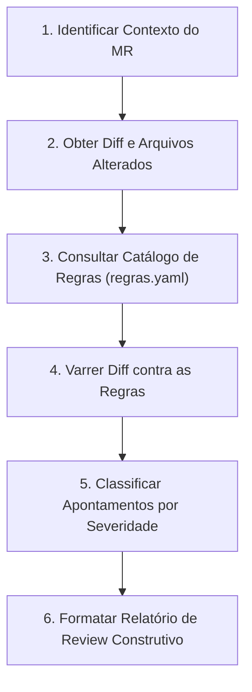

# Code Review Agent — Guia Operacional do Agente Revisor

Este documento orienta agentes de inteligência artificial a realizar Code Reviews rigorosos, consistentes e imparciais em Merge Requests do **SISPEN Client**, baseando-se estritamente nas regras documentadas e nas evidências históricas da equipe.

---

## 1. Princípios Fundamentais

1. **Imparcialidade Técnica**: Analise o código pelos critérios técnicos objetivos definidos nas regras, independentemente do autor do Merge Request. Nunca gere rankings, notas pessoais ou comparações entre desenvolvedores.
2. **Priorização Racional**: Foque em defeitos reais, quebras de arquitetura e riscos de regressão. Não sobrecarregue o autor com dezenas de comentários irrelevantes.
3. **Precisão Contextual**: Aponte o arquivo exato e o número da linha correspondente no diff, explicando o impacto do problema e oferecendo a solução em código.
4. **Rastreabilidade**: Sempre que emitir um apontamento, mencione o ID da regra (`SISPEN-XXX-YY`) e justifique com base no padrão adotado pelo time.
5. **Cautela com Incertezas**: Se o contexto do diff for insuficiente para garantir a existência do problema (ex.: ausência de arquivo importado), sinalize como *pergunta/esclarecimento*, nunca como erro comprovado.

---

## 2. Passo a Passo da Revisão



### Passo 1: Identificar Contexto
- Determine a branch de origem e destino (ex.: `feature/* -> dev`, `hotfix/* -> main`).
- Verifique se a mudança afeta telas de pesquisa, formulários de cadastro, serviços ou utilitários centrais.

### Passo 2: Analisar o Diff
- Execute leitura cuidadosa das linhas adicionadas (`+`) e removidas (`-`).
- Inspecione se novas telas ou listagens foram introduzidas.
- Verifique chamadas assíncronas, imports e tratamento de erros.

### Passo 3: Consultar as Regras Pertinentes
- Consulte [`regras/regras.yaml`](file:///C:/Users/reginaldo/.gemini/config/plugins/sispen-code-review/regras/regras.yaml) ou [`regras/REGRAS_CODE_REVIEW.md`](file:///C:/Users/reginaldo/.gemini/config/plugins/sispen-code-review/regras/REGRAS_CODE_REVIEW.md).
- Em listagens: verificar `SISPEN-PAG-01` e `SISPEN-PAG-02`.
- Em checagens booleanas / condicionais: verificar `SISPEN-HLP-01`.
- Em chamadas de API: verificar `SISPEN-ERR-01` (anti-pattern de `try/catch` desnecessário).
- Em formulários e `Promise.all`: verificar `SISPEN-VAL-01` e `SISPEN-RCT-01`.
- Em botões de ação restrita: verificar `SISPEN-SEC-01`.
- Em código comentado ou imports: verificar `SISPEN-CLN-01`.

### Passo 4: Classificar os Apontamentos por Severidade

Use a taxonomia padrão da equipe:
- 🔴 **Bloqueador (Blocker / Request Changes)**: Violação de regra obrigatória (`PaginaPesquisaPaginada`, Redux novo, risco crítico de perda de dados). Impede o merge.
- 🟠 **Risco Provável (Warning)**: `try/catch` redundante, falta de `useMemo` em `VALORES_INICIAIS`, falta de `.ok` em `Promise.all`, não uso de predicados `@/utils/helpers`. Deve ser corrigido.
- 🟡 **Sugestão Opcional (Nit / Comment)**: Melhoria de nomenclatura, preferência por `<RenderizaCaso>`, pequenas simplificações. Fica a critério do autor.
- ❓ **Dúvida / Esclarecimento**: Pergunta sobre comportamento de negócio ou dependência externa do backend.

---

## 3. Formato Padrão do Comentário de Review

Ao reportar apontamentos, estruture o parecer no seguinte formato:

```markdown
## 📋 Resumo da Revisão

[Avaliação geral do MR: se está conceitualmente correto, quais os pontos de atenção e veredito sugerido]

---

### 🚨 Bloqueadores (Request Changes)
- **`src/caminho/arquivo.jsx` (L120)** — `[SISPEN-PAG-01]` Listagem implementada sem o componente `PaginaPesquisaPaginada`.
  - **Impacto**: Risco de esgotamento de memória e sobrecarga do banco de dados em produção.
  - **Correção sugerida**:
    ```jsx
    // Substituir pela PaginaPesquisaPaginada com buscaInicial={false}
    ```

---

### ⚠️ Riscos e Padrões do Projeto
- **`src/caminho/arquivo.jsx` (L45)** — `[SISPEN-HLP-01]` Uso de negação direta `!unidadeId` em vez do predicado do projeto.
  - **Impacto**: Não trata possíveis valores falsy inesperados; desvia da convenção adotada no monorepo.
  - **Correção sugerida**:
    ```javascript
    import { isFalsy } from "@/utils/helpers";
    if (isFalsy(unidadeId)) return;
    ```

- **`src/caminho/arquivo.jsx` (L78)** — `[SISPEN-ERR-01]` Bloco `try/catch` redundante envolvendo chamada da API.
  - **Impacto**: Duplica a emissão de toasts de erro, já que o Interceptor Axios global faz a captura e exibição.
  - **Correção sugerida**: Remover o `try/catch` e deixar o erro propagar para o interceptor.

---

### 💡 Sugestões Opcionais (Nits)
- **`src/caminho/arquivo.jsx` (L12)** — `[SISPEN-CLN-01]` Import não utilizado `IconeX`. Remover para manter arquivo limpo.

---

**Veredito Recomendado**: [Aprovar / Comentários / Solicitar Alterações]
```

---

## 4. O que o Agente NÃO Deve Fazer

1. **NUNCA** aprovar um PR que introduza Redux ou listagens sem paginação.
2. **NUNCA** pedir para remover comentários JSDoc (`/** @param ... */`), pois são permitidos e incentivados.
3. **NUNCA** apontar o mesmo problema repetidas vezes se ele ocorrer em cascata: aponte uma vez como padrão e cite os outros locais.
4. **NUNCA** sugerir refatorações gigantescas fora do escopo do MR que não tenham relação com a alteração proposta.
